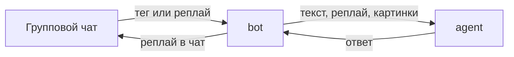

# blg-haluy

Telegram-бот для группового чата. Его тегают или отвечают на его сообщение, он отвечает через LLM: с характером из системного промпта, с поиском в интернете, с разбором картинок и ссылок.

## Старт

1. Возьмите ключ на [странице API keys](https://aistudio.google.com/apikey).
2. Скопируйте пример окружения и вставьте ключ и токен бота:

```powershell
copy .env.example .env
```

3. Установите зависимости и запустите бота:

```powershell
npm install
npm run bot
```

Нужен Node.js 24 или новее. `npm run bot` запускает `tsx --env-file=.env src/index.ts`.

В `.env` задаются `GEMINI_API_KEY`, `GEMINI_MODEL` и `TELEGRAM_BOT_TOKEN`. Файл в git не попадает. Если модель отвечает `503` и пишет `high demand`, поставьте другую: сейчас стабильно отвечает `gemini-3.5-flash-lite`.

## Как устроен

Один процесс Node. `src/index.ts` только связывает слои: из апдейта собирается запрос, пустой отбрасывается, иначе агент возвращает текст и бот шлёт его в чат.

```text
src/
  index.ts                 старт и связь слоёв
  bot/
    telegram.ts            grammY: бот и явное подключение команд и событий
    incoming.ts            апдейт Telegram → готовый запрос
    command/
      index.ts             именные экспорты команд
      startCommand.ts      /start, стрелочная функция от контекста
    events/
      index.ts             именные экспорты событий
      onMessage.ts         сообщение: заглушка, ответ модели, правка текста
    helpers/
      text.ts              фразы чата и обрезка под лимит Telegram
      typing.ts            статус «печатает…», пока модель отвечает
  agent/
    index.ts               клиент LLM
    prompt.ts              системный промпт
    reply.ts               один generateContent
assets/
  start.png                картинка /start; нет файла — в чат уходит только текст
```



`bot/` понимает Telegram. Команды лежат в `src/bot/command`: стрелочная функция от контекста, именной экспорт. События лежат в `src/bot/events`: то, на что бот реагирует помимо команд, сейчас это сообщение. Хелперы лежат в `src/bot/helpers`: фразы чата и статус «печатает…». `import/prefer-default-export` выключен для всего проекта. `telegram.ts` подключает команды явно, например `bot.command('start', startCommand)`. `/start` шлёт подпись; если есть `assets/start.png`, та же подпись уходит под фото. `agent/` получает уже текст и картинки и один раз вызывает модель. Поиск и чтение ссылок делают инструменты этого вызова.

Импорты идут от корня проекта: `src/bot/command`, без относительных путей и без суффикса `.js`.

Как собирать бота и чего в репозиторий не добавлять, записано в [AGENTS.md](AGENTS.md).

## Проверки

```powershell
npm run lint
npm run lint:fix
npm run typecheck
```

Перед коммитом на изменённых файлах запускаются `eslint --fix`, повторный `eslint` и, если среди них есть TypeScript, `typecheck`.
