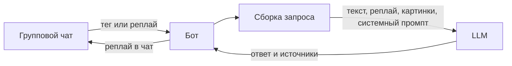

# blg-haluy

Telegram-бот для группового чата. Его тегают или отвечают на его сообщение, он отвечает через LLM: с характером из системного промпта, с поиском в интернете, с разбором картинок и ссылок.

Код бота ещё не написан. В репозитории уже есть клиент модели и проверка ключа.

## Старт

1. Возьмите ключ на [странице API keys](https://aistudio.google.com/apikey).
2. Скопируйте пример окружения и вставьте ключ:

```powershell
copy .env.example .env
```

3. Установите зависимости и проверьте, что модель отвечает:

```powershell
npm install
npm run exp -- src/experiments/hello.ts
```

Нужен Node.js 24 или новее.

В `.env` задаются `GEMINI_API_KEY` и `GEMINI_MODEL`. Файл в git не попадает. Если модель отвечает `503` и пишет `high demand`, поставьте другую: сейчас стабильно отвечает `gemini-3.5-flash-lite`. Токен бота `TELEGRAM_BOT_TOKEN` понадобится, когда появится процесс бота.

## Как устроен

Один процесс Node: чат Telegram, сборка запроса, один вызов LLM, ответ реплаем в тот же чат. Поиск, картинки и ссылки делает модель своими инструментами.



Импорты идут от корня проекта: `src/client`, без относительных путей и без суффикса `.js`. Общий клиент — `src/client.ts`.

Как собирать бота и чего в репозиторий не добавлять, записано в [AGENTS.md](AGENTS.md).

## Проверки

```powershell
npm run lint
npm run lint:fix
npm run typecheck
```

Перед коммитом на изменённых файлах запускаются `eslint --fix`, повторный `eslint` и, если среди них есть TypeScript, `typecheck`.
